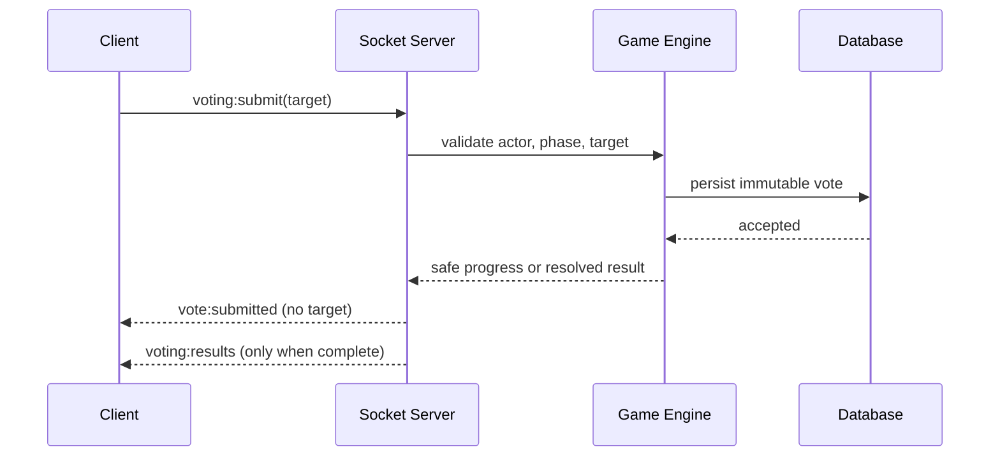

# API and Socket.IO Documentation
**Version:** 1.0 | **Base path:** `/api/v1`

## 1. Contract rules
All state-changing commands require authenticated session identity and server-side authorization. Client-supplied player IDs are never trusted. Validate request bodies with shared schemas. Return sanitized DTOs only. Use stable error codes and correlation IDs.

## 2. REST endpoints
| Method | Path | Purpose | Authorization |
|---|---|---|---|
| POST | `/rooms` | Create room and Host seat | Guest/session |
| POST | `/rooms/:code/join` | Join room | Guest/session |
| GET | `/rooms/:code` | Public room snapshot | Member |
| GET | `/rooms/:code/availability` | Validate joinability | Public or rate-limited |
| PATCH | `/rooms/:code/player` | Rename self | Member; Lobby only |
| PATCH | `/rooms/:code/settings` | Update settings | Host; Lobby only |
| POST | `/rooms/:code/games` | Start game | Host |
| GET | `/rooms/:code/games/current` | Authorized game projection | Member |
| GET | `/rooms/:code/leaderboard` | Room leaderboard | Member |
| POST | `/rooms/:code/rematch` | Start new game | Host; between games |
| POST | `/rooms/:code/close` | Close room | Host |

### Example create room
Request:
```json
{ "displayName": "Aarav" }
```
Response (illustrative):
```json
{
  "room": { "code": "K7P9QX", "status": "LOBBY" },
  "player": { "displayName": "Aarav", "isHost": true },
  "session": { "token": "<issued-secure-session-token>" }
}
```
Never include role or word in room creation response.

### Example start game
Request:
```json
{ "expectedRoomVersion": 12 }
```
Response:
```json
{ "gameId": "game_opaque_id", "phase": "ROLE_REVEAL", "roundNumber": 1 }
```
The caller receives their own role assignment through a private authenticated event or authorized private snapshot, never the complete assignment map.

### Error envelope
```json
{
  "error": {
    "code": "INVALID_GAME_PHASE",
    "message": "This action is not available right now.",
    "correlationId": "req_opaque_id"
  }
}
```
Use appropriate HTTP statuses: 400 validation, 401 unauthenticated, 403 forbidden, 404 missing, 409 conflict, 429 rate-limited, 500 unexpected.

## 3. Socket.IO event contract
Proposed names are normalized to one consistent contract:
| Event | Direction | Visibility | Purpose |
|---|---|---|---|
| `room:join` | Client→Server | command | Join authorized room channel |
| `room:leave` | Client→Server | command | Leave transport channel/room seat policy |
| `room:updated` | Server→Client | room public | Sanitized lobby update |
| `player:joined` | Server→Client | room public | New member |
| `player:left` | Server→Client | room public | Departure status |
| `player:renamed` | Server→Client | room public | Name update |
| `game:settingsUpdated` | Server→Client | room public | Validated settings |
| `game:started` | Server→Client | room public | Game begins |
| `role:assigned` | Server→one player | private | Own role and own word only |
| `speaking:turnStarted` | Server→Client | room public | Current turn |
| `speaking:marked` | Server→Client | room public | Spoken status |
| `discussion:started` | Server→Client | room public | Discussion phase |
| `voting:started` | Server→Client | room public | Voting phase |
| `vote:submitted` | Server→Client | safe aggregate only | Submission progress; no target |
| `voting:results` | Server→Client | public after completion | Aggregate vote totals |
| `player:eliminated` | Server→Client | public | Eliminated player and revealed role |
| `game:ended` | Server→Client | public | Winning team and final outcome |
| `leaderboard:updated` | Server→Client | public | Cumulative scores |
| `game:rematch` | Server→Client | public | New game setup |
| `player:reconnected` | Server→Client | room public | Reconnection status |
| `error:occurred` | Server→requesting client | private | Safe error |

## 4. Command payload examples
`room:join`: `{ "roomCode": "K7P9QX" }` — identity comes from handshake.  
`room:leave`: `{ "reason": "user_action" }`.  
`player:renamed`: `{ "displayName": "Aarav" }` — only Lobby/between-game.  
`game:settingsUpdated`: `{ "settings": { "difficulty": "Easy", "category": "Food", "imposterCount": 1 } }`.  
`game:start`: `{ "expectedVersion": 12 }`.  
`speaking:mark`: `{ "gameId": "opaque", "roundNumber": 1 }`.  
`voting:submit`: `{ "gameId": "opaque", "roundNumber": 1, "targetPlayerId": "opaque_player" }`.

## 5. Authorization and privacy
- Host-only: settings update, start game, start voting, rematch, close room (subject to approved close policy).
- Active players: mark spoken; submit one vote when eligible.
- Eliminated players: public events/results only; no speaking/voting.
- Eliminated Host: Host controls retained where permitted, but no speaking/voting.
- Private: `role:assigned` only to the authenticated player.
- Vote targets must not be included in progress events.
- Public snapshots must use explicit DTO mapping.

## 6. Acknowledgements, retries, and ordering
Use Socket.IO acknowledgements for commands. Include command IDs or idempotency keys for retry-safe operations. Server checks current game version and phase. Clients treat server sequence/version as authoritative and request a fresh snapshot after gaps or reconnect.

## 7. Event flow

