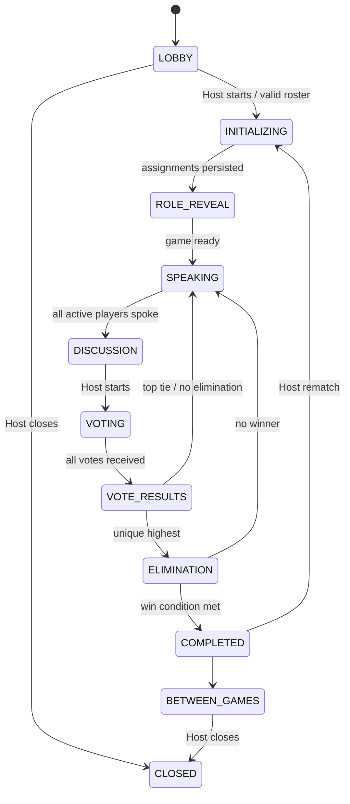

# Game State Machine

## 1. States
`LOBBY`, `INITIALIZING`, `ROLE_REVEAL`, `SPEAKING`, `DISCUSSION`, `VOTING`, `VOTE_RESULTS`, `ELIMINATION`, `COMPLETED`, `BETWEEN_GAMES`, `INSUFFICIENT_PLAYERS`, `CLOSED`.

## 2. Transition rules
| From | Trigger | Guard | To |
|---|---|---|---|
| LOBBY | Host starts | >=3 eligible players; valid settings | INITIALIZING |
| INITIALIZING | Assignment persisted | pair and assignments valid | ROLE_REVEAL |
| ROLE_REVEAL | Reveal acknowledged/phase policy | game ready | SPEAKING |
| SPEAKING | All active players marked | all active eligible completed | DISCUSSION |
| DISCUSSION | Host starts voting | all active players spoken | VOTING |
| VOTING | All eligible votes persisted | one vote per active voter | VOTE_RESULTS |
| VOTE_RESULTS | Result applied | unique top or tie | ELIMINATION or next SPEAKING |
| ELIMINATION | Win check | winner exists | COMPLETED |
| ELIMINATION | No winner | game continues | SPEAKING |
| COMPLETED | Host rematch | room open and minimum met | INITIALIZING |
| COMPLETED | Return to room | — | BETWEEN_GAMES |
| Any open state | Host closes | close policy allows | CLOSED |

`INSUFFICIENT_PLAYERS` is a room/lifecycle condition. Whether an ongoing game transitions into pause when players disconnect is unresolved.

## 3. State invariants
- Only server transitions phases.
- Each command checks current phase and expected version.
- Speaking order is persisted once per game.
- Each active player speaks once per round.
- Each eligible voter submits at most one vote per round.
- Vote results are hidden until all votes arrive.
- Score award is idempotent.
- Completed games cannot accept game actions.

## 4. Mermaid state diagram

## 5. Recovery
On reconnect, authenticate seat, load persisted state, construct role-aware snapshot, and resume UI. Do not infer a transition from client screen state. Disconnect-specific pause/forfeit behavior remains open.
