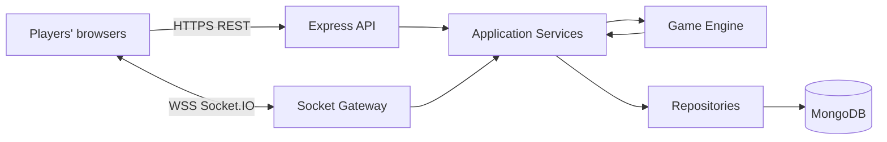
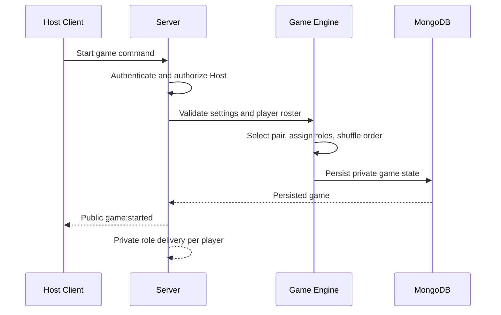

# System Architecture
**Version:** 1.0

## 1. Architecture style
Use a modular monolith for MVP: one Node.js deployment containing REST, Socket.IO, domain/game engine, and persistence adapters. This reduces operational complexity while preserving module boundaries for future extraction.

## 2. Logical components
- React client: presentation, forms, local animation, authorized state display.
- REST controller layer: room lifecycle and snapshot endpoints.
- Socket gateway: authenticated real-time commands and broadcasts.
- Application services: room, player, settings, game, leaderboard, dataset services.
- Game engine: pure domain functions for role distribution, turn completion, vote resolution, victory, scoring.
- Persistence layer: Mongoose repositories and atomic operations.
- MongoDB: room, player, game, word-pair, optional event/vote records.

## 3. Trust boundaries
Browser is untrusted. Socket payloads are untrusted. Database documents are not automatically safe to serialize. The server derives actor identity from session, verifies membership and role, checks current phase, and builds recipient-specific DTOs.

## 4. High-level diagram

## 5. Game start sequence

## 6. State ownership
Only backend owns phase, assignments, speaking progress, vote records, elimination, winner and scores. Client stores a projection plus transient UI state. On reconnect, server sends a fresh projection based on the player's current permissions.

## 7. Realtime topology
Join each socket to a room broadcast channel and a private player channel. Validate that the socket's authenticated session maps to the player seat before joining. Never trust arbitrary room names supplied by the client. Use sticky sessions or a Socket.IO adapter if horizontal scaling is introduced; ensure adapter and deployment support WebSockets.

## 8. Consistency and persistence
Use versioned state transitions. Guard vote submission with unique voter/game/round constraint. Guard score award with one-time completion marker. Store speaking order once per game. Avoid emitting success before durable state is committed.

## 9. Deployment topology
Static frontend → HTTPS API/WebSocket endpoint → persistent Node process → managed MongoDB. Configure CORS allowlist, TLS, health checks, secrets, logs, and backups. Do not deploy WebSocket backend as a short-lived serverless function unless the provider explicitly supports the required persistent connection model.

## 10. Scaling and resilience
Start with one backend instance for MVP if capacity is adequate. For multiple instances, use shared Socket.IO adapter, shared session store, distributed rate limiting, and database concurrency guards. Define reconnect and recovery semantics in OPEN_QUESTIONS.md before claiming seamless recovery.
