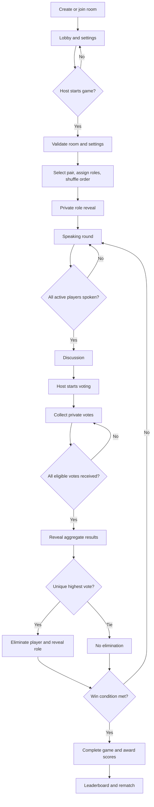

# Application Workflow
**Version:** 1.0

## 1. Room creation
1. User opens landing page and chooses Create Room.
2. Client submits create request.
3. Server creates room, generates collision-resistant code, creates Host player seat/session, and persists room.
4. Server returns room code, invitation URL, and authorized lobby snapshot.
5. Client displays share/copy actions.

## 2. Joining
1. User enters code or opens invite URL.
2. Client submits join request with display name.
3. Server normalizes name and checks room status, capacity, duplicate identity/name, and join policy.
4. Server creates or resumes a player seat according to the approved reconnect policy.
5. Server emits sanitized `player:joined` and updated lobby state to room members.

## 3. Lobby and settings
- Lobby displays connected players, Host marker, room code, and readiness/connection indicators.
- Only Host may change game settings and start the game.
- Names are editable only in Lobby/between-game state.
- Server validates player bounds, imposter count, category, difficulty, and eligible dataset availability before accepting settings or start.

## 4. Game initialization
1. Host sends start command.
2. Server verifies Host permission, room state, connected player count, and settings.
3. Server selects one active approved word pair matching filters.
4. Server shuffles player roles using secure server-side randomness.
5. Server assigns roles and corresponding words.
6. Server creates fixed Fisher-Yates speaking order.
7. Server persists game ID, state, assignments, order, and round number.
8. Server sends public game-start snapshot to room and private role/word payload to each player.

## 5. Role reveal
Each client shows a local mystery card. Only the authenticated player's private assignment is available to that client. Hide Role hides local display; it does not change server assignment. Reopening role details must require a deliberate user action and remain private.

## 6. Speaking
- Server stores the fixed order and active-player eligibility.
- Current turn is derived from order and current round completion state.
- Player marks spoken; server checks game/round, membership, active status, and duplicate action.
- Server broadcasts public completion status without revealing words.
- When every active player has spoken, server changes phase to discussion.

## 7. Discussion and voting
- Discussion is untimed by default.
- Host initiates voting.
- Server checks all active players have spoken and actor is Host.
- Eligible voters are all active players, including active Host.
- Each voter submits one target other than self.
- Server stores vote privately and broadcasts only aggregate submission progress, not target choices.
- When all eligible votes arrive, server reveals results.

## 8. Resolution
- Unique highest count: eliminate that player.
- Tie for highest: no elimination.
- Reveal only the eliminated player's role after the result is finalized.
- Recompute remaining team counts.
- Innocents win if no Imposters remain.
- Imposters win if remaining Imposters >= remaining Innocents.
- If no winner, begin another round using the same speaking order and remaining active players.

## 9. Completion and scoring
On first transition to completed state, award +10 to each player whose assigned team won, including eliminated players. Losing team receives 0. Mark score award as completed atomically/idempotently. Update cumulative leaderboard and broadcast public result.

## 10. Rematch and close
Host starts rematch from permitted between-game state. Create a new game record; clear role assignments, words, votes, round completion, eliminations, and per-game speaking progress. Preserve room-level cumulative scores. Closing room invalidates future joins and should follow the approved close policy.

## 11. Disconnect/reconnect
The server marks transport connection status separately from game elimination. Reconnect restores the same authorized seat only after identity/session verification. Exact grace period, whether disconnected players count as active, and vote handling after disconnect are unresolved; see OPEN_QUESTIONS.md.

## 12. Mermaid: primary game flow

